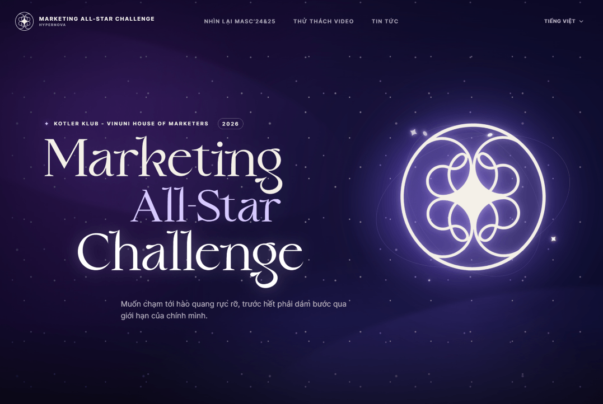

# Marketing All-Star Challenge — Hypernova

A competition and event platform for **Marketing All-Star Challenge 2026**, bringing together the public website, participant dashboard, and organizer tools in one application. Built for the competition by Kotler Klub and VinUni House of Marketers.

Participants can explore the competition, register their teams, submit work across rounds, and purchase event tickets. Organizers can manage admissions, review submissions, communicate with teams, and handle event check-in.

## Features

### Competition website

- **Animated landing page** with a space-inspired visual identity, GSAP animations, and a configurable registration countdown.
- **Competition information** covering the timeline, mentors, and rulebook.
- **English and Vietnamese** interfaces with a language switcher.
- **Google sign-in** with persistent sessions and access to participant tools.

### Participant dashboard

- **Team registration** with member details and round-specific admission workflows.
- **CV screening and track preferences** with CV and supporting-document uploads.
- **Round submissions** with problem statement previews, file uploads, submission status, and attempt limits.
- **Results and updates** through published scores, feedback, promotion notices, and announcements.
- **Private file access** through authorized, short-lived upload and download URLs.

### Organizer workspace

- **Team and user management** across competition rounds, including admissions, CV screening, track assignments, and team progression.
- **Submission review** with scoring, feedback publication, and controls for submission availability.
- **Competition settings** for countdowns, round problem statements, and announcements.
- **Email campaigns** with audience filters, a rich text editor, personalized templates, and previews.
- **Data exports** for team and submission spreadsheets, plus bulk PDF downloads as ZIP archives.
- **Role-based administration** with separate access for competition organizers and entrance staff, plus activity logs.

### Ticketing and event check-in

- **Ticket checkout** with PayOS payments, promo codes, order status, and purchase history.
- **Digital tickets** with QR codes, downloadable ticket images, and email delivery.
- **Ticket operations** for purchased orders, gifted ticket batches, refunds, payment reconciliation, and customizable ticket templates.
- **QR check-in** with camera scanning, ticket lookup, and check-in logs.

## Technology stack

| Area | Technologies | Purpose |
| --- | --- | --- |
| Application | Next.js 16, React 19, TypeScript | App Router pages, server rendering, and typed application code |
| UI and styling | Tailwind CSS 4, shadcn/ui, Base UI, Lucide, Sonner | Shared components, styling, icons, and notifications |
| Animation | GSAP | Landing page motion and scroll animations |
| Localization | next-intl | English and Vietnamese messages and locale handling |
| API and data fetching | tRPC 11, TanStack Query, Zod | Typed client/server calls, query caching, and input validation |
| Authentication | Better Auth, Google OAuth | Sign-in and session management |
| Database | PostgreSQL, Neon, Drizzle ORM | Persistent data, typed queries, and SQL migrations |
| File storage | Cloudflare R2, AWS S3 SDK | Private uploads and signed file access |
| Payments | PayOS | Ticket checkout and payment webhooks |
| Email | ZeptoMail | Participant communications and ticket delivery |
| Tickets and exports | ZXing, qrcode, Sharp, write-excel-file | QR scanning, ticket image generation, and spreadsheet exports |
| Background exports | Node.js, Archiver, esbuild, Render | PostgreSQL-backed jobs that stream PDF ZIP archives to R2 |
| Workspace | pnpm | Shared packages and workspace dependency management |

## Project structure

```text
masc-landing/
├── apps/
│   ├── web/           # Next.js website, participant dashboard, and admin tools
│   └── pdf-exporter/  # Background service for bulk PDF ZIP exports
├── packages/
│   ├── api/           # tRPC routers, business rules, email, tickets, and storage
│   ├── auth/          # Better Auth configuration and session helpers
│   ├── db/            # Drizzle schemas, queries, and generated migrations
│   ├── env/           # Validated server and browser environment variables
│   ├── ui/            # Shared UI components, hooks, and global styles
│   └── config/        # Shared TypeScript configuration
└── render.yaml        # PDF exporter deployment configuration
```

## Local development

Use Node.js and pnpm installed in your development environment. Run commands from the repository root.

```bash
pnpm install
cp apps/web/.env.example apps/web/.env
```

Fill in `apps/web/.env` with your PostgreSQL connection, Better Auth settings, Google OAuth credentials, private R2 bucket credentials, and ZeptoMail configuration. The [environment template](apps/web/.env.example) documents each variable; ticketing and the PDF exporter have additional settings.

For a new database, confirm that `DATABASE_URL` points to the intended target, then apply the committed migrations with `pnpm db:migrate`. This command changes the configured database.

```bash
pnpm dev:web
```

Open [localhost:3000](http://localhost:3000). Registration and ticket sales visibility are controlled by `NEXT_PUBLIC_IS_REGISTRATION_OPENED` and `NEXT_PUBLIC_IS_SELLING_TICKETS_OPENED`; rebuild after changing browser-visible flags in a deployed environment.

### Validation

Check the web application's TypeScript types:

```bash
pnpm --filter web exec tsc --noEmit
```

Run the production build with the required environment configured:

```bash
CI=1 NEXT_TELEMETRY_DISABLED=1 pnpm --filter web exec next build --webpack
```

The root `pnpm check-types` runs only packages that define a `check-types` script; it does not check the web application. See [AGENTS.md](AGENTS.md) for package-specific checks and database workflows.

<details>
<summary>Storage and background export setup</summary>

### Private file storage

Keep the R2 bucket private. Configure `R2_ACCOUNT_ID`, `R2_ACCESS_KEY_ID`, `R2_SECRET_ACCESS_KEY`, and `R2_BUCKET`, and allow uploads from each web application origin with a bucket CORS policy:

```json
[
  {
    "AllowedOrigins": ["http://localhost:3000", "https://your-production-origin.example"],
    "AllowedMethods": ["PUT"],
    "AllowedHeaders": ["Content-Type"],
    "MaxAgeSeconds": 300
  }
]
```

Replace the example production origin with your deployed origin. Downloads use short-lived authorized URLs and do not require a public bucket domain.

### Bulk PDF exports

The exporter claims jobs from the same PostgreSQL database as the web app, streams the latest PDF from each team into a ZIP, and uploads the archive to R2. Archives expire after 24 hours by default.

Deploy the service using the [Render Blueprint](render.yaml). Configure `DATABASE_URL` and the same R2 credentials as the web app, with read, write, and delete access to the bucket. Set `PDF_EXPORTER_URL` in the web app to the deployed service origin. The admin interface calls its `/health` endpoint to wake an idle Render Free instance, which can take about a minute.

Optional worker settings are `EXPORT_TTL_HOURS`, `POLL_INTERVAL_MS`, `JOB_STALE_AFTER_MINUTES`, and `JOB_MAX_ATTEMPTS`. No Redis instance or persistent disk is required.

To run the exporter locally, load its database and R2 variables into your shell, then run:

```bash
pnpm --filter pdf-exporter build
pnpm --filter pdf-exporter start
```

</details>

Originally scaffolded with [Better-T-Stack](https://github.com/AmanVarshney01/create-better-t-stack).
